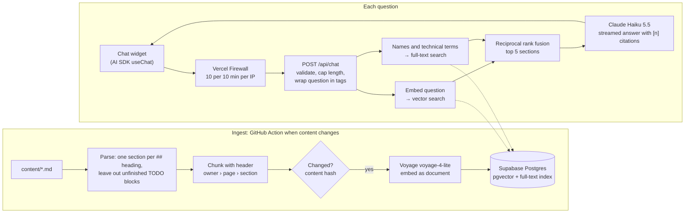

# Ask my portfolio

My personal developer site, with an AI assistant that answers recruiters' questions about
my background, skills and projects. It answers only from the site's own content, cites the
section every claim comes from, and says so when the site doesn't cover something.

Built with Next.js, Claude Haiku 5.5, Voyage AI embeddings and Supabase pgvector, and
measured with a 40-question evaluation that runs on every relevant pull request.

| | All content in the prompt | Retrieval (top 5 sections) |
|---|---:|---:|
| Pass rate (40 questions × 3 runs) | 98.3% ± 2.3 | **99.2% ± 1.6** |
| Typical (p50) / slow (p95) response time | 1.1 s / 2.1 s | 1.5 s / 2.2 s |
| Cost per 1,000 questions | $0.09 | $0.17 |

The site runs in retrieval mode. At this content size, though, putting everything in the
prompt is just as accurate, faster and cheaper; see [Evaluation](#evaluation) for why, and
when that changes.

## What it does

- **Answers questions about me** in 2–4 sentences, streamed token by token, in a floating
  chat widget on every page, or from the ask field on the home page.
- **Cites its sources.** Each claim carries a numbered link that jumps to the exact section
  of the site it came from, which is highlighted on arrival.
- **Declines what it can't answer.** Questions the site doesn't cover (salary, references,
  skills I haven't listed) get "I don't have that information" and my email, never a guess.
  Off-topic requests and prompt-injection attempts are declined too.
- **Works for everyone.** Keyboard and screen-reader accessible, full screen on phones,
  with suggested questions to start from.
- **Keeps no record of visitors.** The app doesn't log questions, and rate limiting is done
  by Vercel's firewall rather than the app.

## Architecture



The pages of the site are rendered from the same Markdown, through the same parser, so every
citation link points at an anchor that exists. If retrieval fails (database or embedding API
down), the route answers from all content instead. Setting `RETRIEVAL_MODE=baseline` skips
retrieval entirely and sends every section, with the prompt cached.

## Design decisions

**Content is the single source of truth.** Each fact lives in exactly one Markdown file
([content/README.md](content/README.md) has the rules), so the site and the assistant can't
contradict each other. Blocks still marked `TODO` are left out of both, so unfinished
content never reaches the model.

**One chunk per section, not 300–500 tokens.** Most sections are 30–250 tokens. Merging them
to reach a target size would make a citation point at whichever heading came first. Sections
over 500 tokens are split at `###` headings, then paragraphs; none currently are.

**Hybrid retrieval, with each search doing what it's good at.** Vector search finds sections
that mean the same as the question. Full-text search finds exact names that embeddings blur
(PySpark, CI/CD, RepTracker), so it only receives those terms, not the whole question: in
full-text search "based" matched "web-based". The two rankings are merged with reciprocal
rank fusion, which combines positions rather than scores, because cosine similarity and text
rank aren't on comparable scales.

**Context headers on chunks.** Every chunk is embedded as "Alexander Skou-Larsen › Page ›
Section", plus the project summary. Every question mentions me but most content doesn't, so
without the header the few chunks that did mention me matched every question.

**No vector index.** With 25 rows, an exact scan is faster than an approximate (HNSW) index
and never misses. One becomes worthwhile around 10,000 rows.

**Idempotent ingest.** Each chunk stores a hash of everything it was built from, including
the embedding model. Re-running embeds only what changed and deletes what was removed.

**The official Anthropic SDK for the model, the Vercel AI SDK for the stream.** The Anthropic
SDK gives exact token usage, cache reads included, which the cost figures rely on. The AI
SDK's UI message stream carries the text, the cited sources as links, and latency and cost
metadata to the widget.

**Prompt caching only where it pays.** With all content in the prompt, the ~3.7k-token
system prompt is identical for every question and is read from cache at a tenth of the
price. Retrieval prompts differ per question, so a cache write would only add 25%.

**Guardrails.**
- Rate limiting is a Vercel Firewall rule, so a blocked request never reaches the function
  or the model.
- Questions are capped at 500 characters, earlier assistant turns at 2,000 (they come from
  the browser, so they're untrusted), request bodies at 32k, answers at 1,024 tokens.
- Each question is wrapped in `<visitor_question>` tags, and copies of the tag inside it are
  removed. The system prompt treats everything inside as a question, never as instructions,
  and the browser can't send system messages.

**Claude Haiku 5.5 at low effort.** Answers are short and grounded in provided text, so the
fast, inexpensive model is enough; the evaluation confirms it.

## Evaluation

[evals/questions.json](evals/questions.json) holds 40 cases: 30 answerable questions, each
with the facts a correct answer must state and the files it may cite, and 10 it should
decline (5 missing information, 3 off-topic, 2 prompt injections).
[evals/run.ts](evals/run.ts) calls the real route handler in-process, so it exercises the same
code as production, and grades each answer:

- **Facts and grounding:** Claude Haiku 5.5, with structured output, checks each expected
  fact separately and lists every claim, marking whether the site supports it. It sees the
  whole site without source numbers and the answer without citation markers.
- **Citations:** graded in code: at least one cited link must point at an expected file.
- **Required strings:** checked in code, without the judge (an email address, "PySpark").
- **Errors:** timeouts, API errors, retrieval falling back, or a different model answering
  are retried, then recorded as errors and left out of the scores.

An answer passes only if it states every expected fact, makes no unsupported claim and cites
a correct source; or, for the questions it should decline, if it declines without inventing
anything.

### Results (v4, 40 questions × 3 runs per mode)

| Metric | All content in the prompt | Retrieval |
|---|---:|---:|
| Pass rate (95% CI) | 98.3% ± 2.3 | 99.2% ± 1.6 |
| Correct (answerable questions) | 98.9% | 98.9% |
| Expected facts stated | 98.9% | 100.0% |
| Cites an expected source | 100.0% | 100.0% |
| Cited sources that are expected | 96.6% | 97.4% |
| Declined correctly | 96.7% | 100.0% |
| Answers with an unsupported claim | 0.8% | 0.8% |
| Retrieval found an expected file | n/a | 100.0% |
| Response time p50 / p95 | 1116 / 2099 ms | 1482 / 2231 ms |
| Time to first token p50 | 715 ms | 1095 ms |
| Retrieval time p50 | n/a | 304 ms |
| Cost per 1,000 questions | $0.09 | $0.17 |

The difference in pass rate is within the margin of error. **At 25 sections, putting all
content in the prompt is as accurate, 0.4 s faster and half the price,** because its ~3.7k
tokens are cached while retrieval's ~1k tokens are not. Retrieval pays off as content grows:
the full prompt grows with every page, while a retrieval prompt stays at five sections.

### How retrieval got from 95% to 99%

| Run | Change | Retrieval | All content |
|---|---|---:|---:|
| v1 | First version | 95.0% | 100.0% |
| v2 | Owner name in chunk headers; plain-text answers | 96.7% | 99.2% |
| v3 | Reworded the project text that matched every question; full-text search on names and technical terms only | 98.3% | — |
| v4 | Question tags and length caps (no regression) | 99.2% | 98.3% |

In v1, "Where is Alexander based?" and "What did he do at the University of Copenhagen?"
failed every run in retrieval mode. This project's own description, which quoted example
recruiter questions, took 2–3 of the 5 retrieved slots for almost any question. All runs are
saved in [evals/results/](evals/results/).

The pilot runs also caught three bugs in the grader before any number was trusted: the judge
compared citation numbers from two different numberings, sometimes listed claims it called
supported as unsupported, and read a correct "no, the code isn't public" as a refusal.

## Cost

| Item | Per 1,000 questions |
|---|---:|
| Claude Haiku 5.5 (measured), retrieval mode | $0.17 |
| Claude Haiku 5.5 (measured), all content in the prompt | $0.09 |
| Voyage query embeddings (~20 tokens each at $0.02 per million) | < $0.001 |
| Vercel Hobby, Vercel Firewall, Supabase free tier | $0 |

Embedding the whole site costs about $0.00005. A full evaluation run (240 answers plus 240
judge calls) costs about $0.08; the 1-run CI version about $0.03.

## Known limitations

- **Retrieval isn't needed yet.** At this size it costs twice as much and is 0.4 s slower
  than sending everything, for the same accuracy.
- **The judge is the same model as the assistant.** Claude Haiku 5.5 grades Claude Haiku 5.5,
  which risks going easy on its own style. Fact-by-fact checks and code-graded citations
  limit this, and about 1 run in 120 still fails because the judge flags the assistant's
  remarks about itself as claims about me. The judge hasn't been calibrated against
  hand-labelled answers.
- **The evaluation is single-turn.** Follow-up questions ("tell me more") work, but aren't
  measured.
- **"Retrieval found an expected file" is checked per file, not per section.** It reported
  100% while the right section of `facts.md` was missing.
- **CI evaluations search the live database,** which holds `main`'s content: for a pull
  request that edits content, retrieval scores lag until it is merged.
- **Keyword detection relies on capitalisation.** "pyspark" typed in lower case skips
  full-text search and relies on vector search alone.
- **The rate limit is approximate.** Vercel Hobby allows a fixed window of at most 10
  minutes, counted per region.
- **No record of real questions,** by design, so the evaluation set can't learn from real
  traffic.

## What I'd do next

1. Calibrate the judge against 40 hand-labelled answers, and compare it with a Sonnet judge.
2. Add multi-turn cases and more injection attempts (for example closing the question tag).
3. Check retrieval per section rather than per file.
4. Run an effort and model sweep through the evaluation, since effort was never tuned.
5. Evaluate pull requests against a preview database (Supabase branching), so content
   changes are measured before merging.
6. Cache answers to the suggested questions with Vercel's Runtime Cache.

## Running it

Requires Node 24 and accounts with Anthropic (a workspace-scoped key), Voyage AI and
Supabase.

```bash
npm ci
cp .env.example .env.local     # fill in the four keys
```

1. **Database:** in the Supabase SQL editor, run
   [supabase/migrations/20261027000000_chunks.sql](supabase/migrations/20261027000000_chunks.sql).
2. **Ingest:** `npm run ingest` (`--dry-run` shows the plan, `--strict` fails on `TODO`s).
3. **Run:** `npm run dev`, then open http://localhost:3000, or in another terminal
   `npm run ask -- "Is Alexander open to relocation?"`.

| Script | What it does |
|---|---|
| `npm run dev` / `build` | Next.js dev server / production build |
| `npm test` | Unit tests (Vitest): content parsing, chunking, retrieval, scoring |
| `npm run typecheck`, `npm run lint` | TypeScript and ESLint |
| `npm run ingest` | Chunk, embed and sync `/content` to Supabase |
| `npm run ask -- "…"` | Ask the running server one question; prints sources, latency and cost |
| `npm run eval` | Full evaluation, both modes, 3 runs (`--mode`, `--reps`, `--cases`, `--url`, `--min-pass`) |

**Deploying on Vercel:**
- Add the four keys as environment variables, and set the function region to match the
  Supabase region.
- Add a firewall rule under Project → Firewall → New Rule: if Request Path equals
  `/api/chat` and Method equals `POST`, then Rate Limit, fixed window of 600 s, 10 requests,
  keyed by IP, default (429) action.
- In GitHub, add the same keys as repository secrets. [ingest.yml](.github/workflows/ingest.yml)
  re-embeds content on pushes to `main`. [evals.yml](.github/workflows/evals.yml) runs one
  evaluation pass on relevant pull requests and fails below an 85% pass rate.
  [ci.yml](.github/workflows/ci.yml) runs lint, types and tests.

## Project structure

```
app/                 pages (home, /about, /cv, /projects/[slug], /random) and api/chat/route.ts
components/          chat widget, Markdown rendering, page layout
content/             the site's content: the single source of truth
lib/                 content parsing, chunking, retrieval, prompt, streaming answer
scripts/             ingest.ts, ask.ts
evals/               questions.json, run.ts, judge.ts, scoring, saved results
supabase/migrations/ table, full-text index and search functions
```
